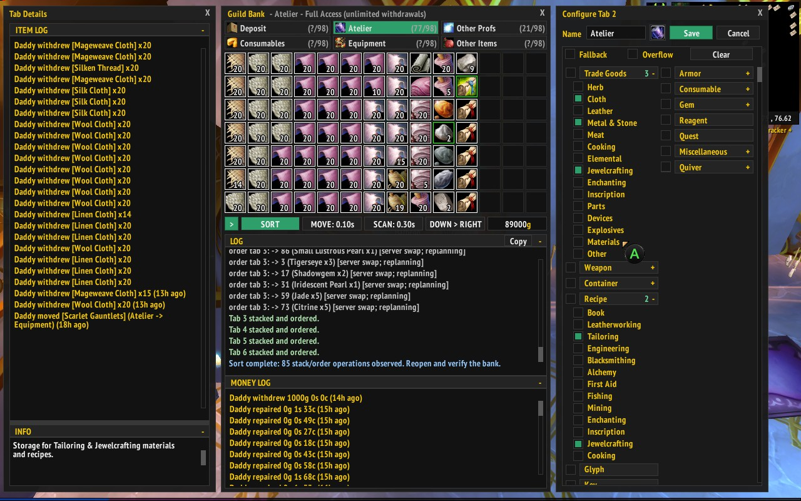
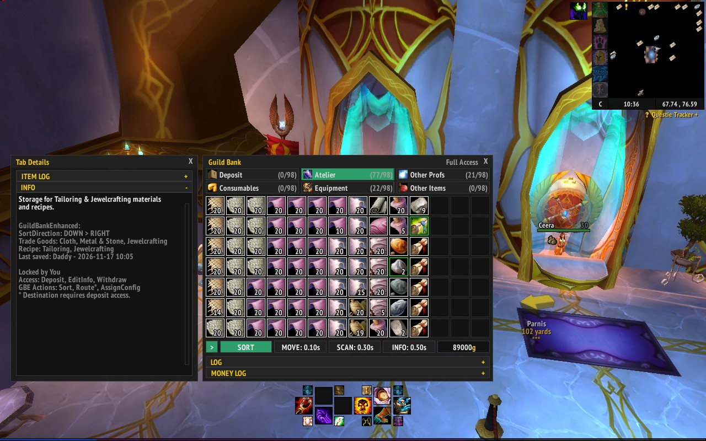
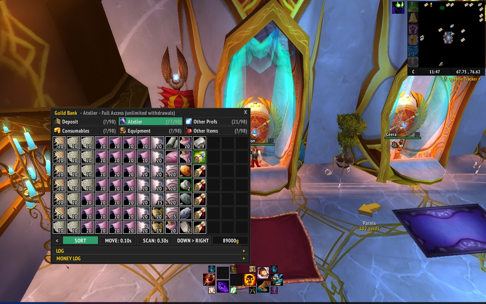

# Guild Bank Enhanced

Organise your guild bank with one click. Guild Bank Enhanced routes items to tabs by type and subtype, combines partial stacks and sorts each tab—all from a consolidated bank interface for World of Warcraft 3.3.5a.

## Features

- Assign item types or specific subtypes to tabs, with optional fallback and overflow tabs.
- Combine partial stacks and sort each tab in your chosen direction.
- View the bank, money log, item log and tab Info together, or collapse the sections you don’t need.
- Share assignments and sort directions with other addon users in your guild.

## Getting started

Right-click a tab to choose its assignments, fallback or overflow role, and sort direction. Save your changes, then click **Sort**. Each tab has its own direction; the default is Down > Right.

Settings are stored in tab Info and normally picked up automatically when another member first opens the bank with the addon. If settings later differ, review each tab separately. An organiser can **Use bank settings**, **Apply saved settings** from their character, or **Skip tab**. An organiser needs Update Tab Text access on both tab 1 and the affected tab to use these organiser options.

Members without that access can use readable bank settings when the last saver is known, or skip the tab. If the last saver is unknown, ask an organiser to review and save the settings. Damaged settings cannot be accepted; they must be repaired by an organiser.

Skipped tabs are excluded from addon routing, stacking and sorting. They are marked orange and, if still unresolved, presented for review again the next time you open the bank. Right-click a tab and choose **Review settings** to reconsider it during the same visit. If a skipped tab has or had a fallback or overflow role, alternative routing is paused too.

**Upgrading from 1.0.3?** Note your existing assignments, fallback/overflow roles and sort direction before updating. They aren’t imported automatically, so you’ll need to set them on the bank once.

## Managing guild access

In the guild window, use **Guild Control** to set bank permissions for each rank and tab. The game’s guild bank permissions still apply; the addon cannot give members extra access.

**Update Tab Text on tab 1 is the master switch for all addon sorting and tab configuration.** Without it, members cannot sort or change the configuration of any tab through the addon, even if they can update text on other tabs. They can still see the shared settings and use the bank according to their normal permissions.

- **Bank organisers:** Give their rank **View Tab** and **Update Tab Text** on tab 1. They also need Update Tab Text on each tab they configure.
- **Other members:** Leave Update Tab Text unchecked on tab 1 if they shouldn’t sort or change addon settings.
- **Sorting and routing:** Give organisers View Tab and Deposit Items on tabs they should sort. Routing also needs deposit access on the destination and at least **1,000 withdrawals remaining**, or unlimited withdrawals, on the source. A warning appears before routing from a limited allowance.

Tabs a member can’t view are greyed out, but can be right-clicked to inspect their configuration. An inaccessible tab with an unresolved settings issue has an orange border. The Info panel shows the current lock, access and available actions.

## Working together

A shared lock helps prevent addon users sorting or changing settings at the same time. If another member holds it, wait for them to finish. If they’ve disconnected, the addon will try to reclaim it; a guild master can also right-click **Sort** to confirm a force unlock. Check they aren’t still working first.

If tab settings become damaged, an organiser with Update Tab Text access on both tab 1 and the affected tab can apply their character’s saved settings when available, or confirm **Reset tab**. A reset clears the tab’s assignments and roles and returns its sort direction to the default, so check the settings before sorting or routing. Other members must wait for a repair; while a damaged tab is skipped, routing between other tabs is also paused because its assignments are unknown.

If tab 1 is damaged, addon sorting and configuration are paused until it’s repaired. Check that nobody else is working in the bank before restoring or resetting it, because its lock cannot be read.

The addon records the newest version in tab 1 when an organiser can safely hold the lock. If your version is older than the recorded version, update it before sorting or changing settings. Versions released before this check cannot be relied on to enforce it.

The lock coordinates compatible addon versions; it doesn’t replace guild permissions or prevent use of the standard bank. Use the addon’s Info panel to edit descriptions while keeping shared settings intact.

## Delays

The bottom bar has per-character **Move**, **Scan** and **Info** delays, defaulting to 0.10, 0.30 and 0.50 seconds respectively. Info controls the pace of shared settings and lock updates. Setting delays too low can cause errors or server disconnects; if this happens, increase them.

## Screenshots

See the [changelog](changelog.md) for release notes.
